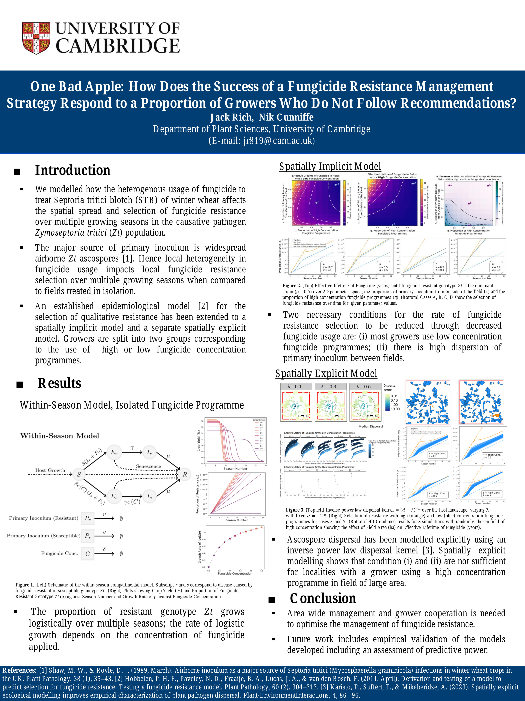

This repository contains the code and resources developed for my Part III Systems Biology research project investigating the spatial spread of fungicide resistance in _Zymoseptoria tritici_, a fungal pathogen responsible for the disease septoria tritici blotch in wheat. The work was presented at the _Episense_ satellite meeting during the International Congress of Plant Pathology (ICPP 2023) in Lyon, France, 2023.

### One Bad Apple: How Does the Success of a Fungicide Resistance Management Strategy Respond to a Proportion of Growers Who Do Not Follow Recommendations?

A modelling approach has been taken to address the question of how spatially
heterogeneous fungicide use to treat Septoria tritici blotch (STB) of winter wheat affects
the rate of fungicide resistance selection in the population of the causative fungal
pathogen Zymoseptoria tritici (Zt), over multiple growing seasons. Many fields of winter
wheat are grown in close proximity over agricultural areas with the major source of Zt
primary inoculum being widely dispersed airborne ascospores. Hence the rate of selection
of fungicide resistance in the Zt population, over many years, depends on the fungicide
usage of all growers over an area.

An established epidemiological model for the selection of qualitative resistance for Zt has
been extended to a spatially implicit model and a separate spatially explicit model.
Growers are divided into two groups based on the dose of fungicide they apply. The
spatially implicit model illustrates two necessary conditions for the rate of fungicide
resistance selection to be reduced through decreased fungicide usage: (i) most growers
use decreased concentration fungicide programmes; (ii) there is high dispersion of primary
inoculum between fields. In the spatially explicit model, ascospore dispersal is modelled
explicitly using an inverse power law dispersal kernel. Spatially explicit modelling shows
that condition (i) and (ii) are not sufficient for localities with a grower using a high
concentration fungicide programme in a field of large area, and in such cases the rate of
fungicide resistance selection is substantially increased over their locality, regardless of
majority low fungicide usage and high dispersion of primary inoculum.

[Read the project report (PDF)](NST3SN_Project_P9_Jack_Rich.pdf)

